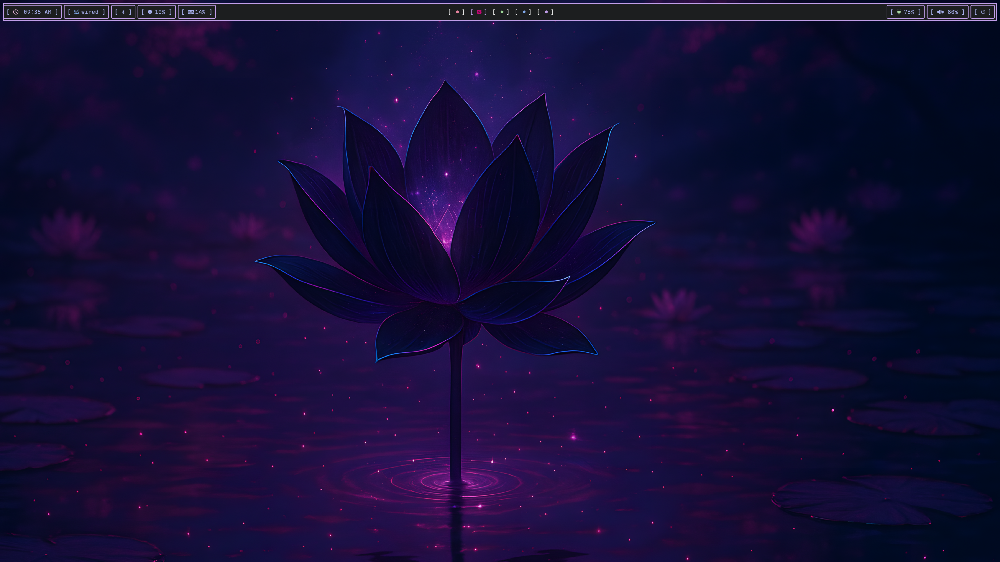
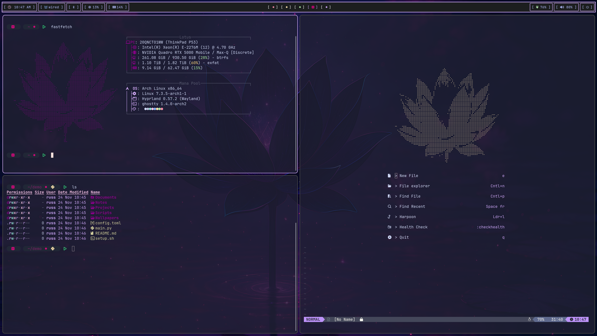
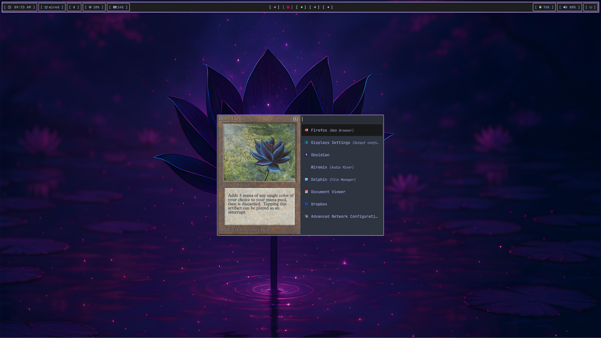

# Dotfiles

The following are a snapshot of my current dotfiles for my Linux workstation themed after an iconic Magic the Gathering playing card, Black Lotus.  My config is, of course, inspired by Pewdie-Pie's dionysus setup with a catppuccin-mocha twist.  The workstation is a slightly older Lenovo Thinkpad P53 running Ubuntu with Hyprland compositor.  Enjoy!

  

  

  

## Acknowledgments

Special thanks to [Omarchy](https://github.com/omacom/omarchy)
and its contributors for the clipboard, screenshot, and
Quickshell components adapted for Lotus.

See [Third-Party Notices](THIRD_PARTY_NOTICES.md) for
attribution and licensing information.
